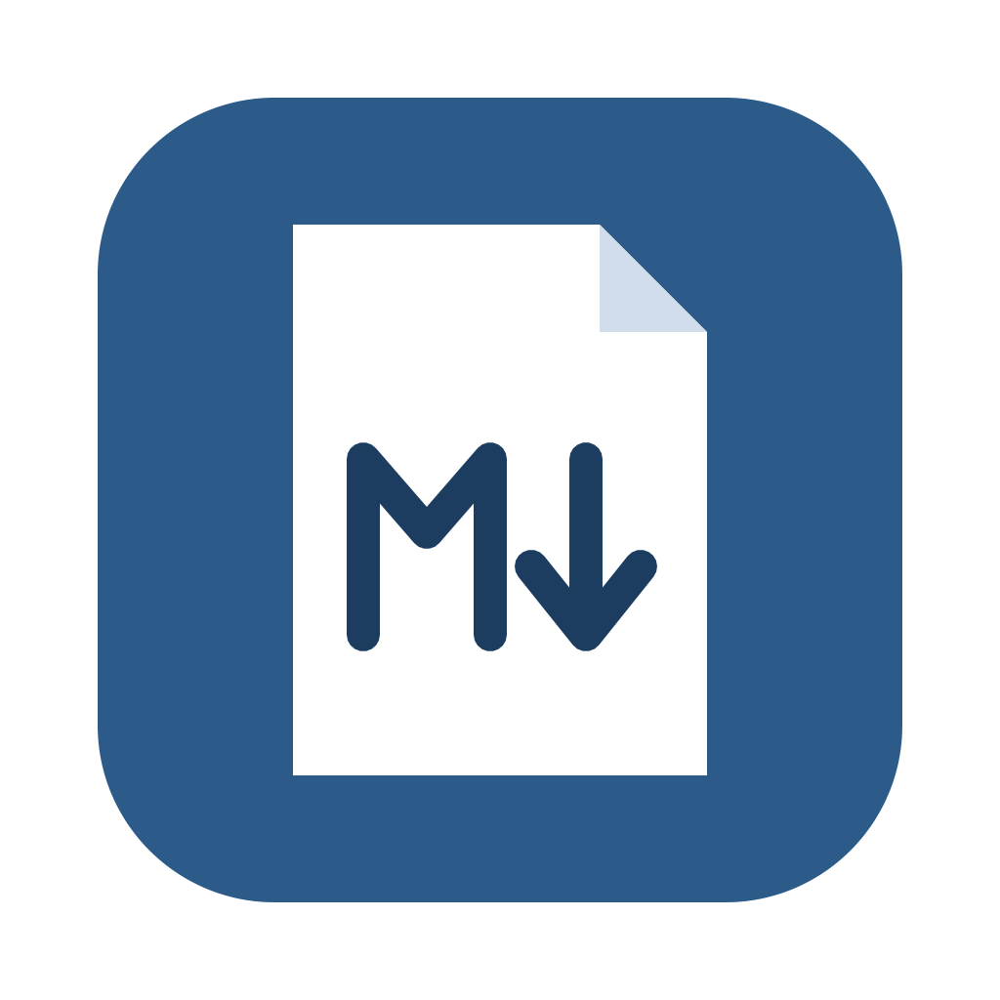

<p align="center"></p>

# PDF til Markdown

*[English](README.md) · Norsk*

En liten Mac-app som gjør om PDF-er til Markdown. Dra filene inn i vinduet, så lagres en `.md`-fil per PDF i `~/Documents/PDF til Markdown`. Alt skjer lokalt på maskinen, og ingenting sendes noe sted.

Konverteringen gjøres med [pymupdf4llm](https://github.com/pymupdf/pymupdf4llm), som kjenner igjen overskrifter, lister, fet og kursiv tekst og tabeller. Skannede sider uten tekstlag leses med tekstgjenkjenning (Tesseract-OCR) på norsk og engelsk. Har en PDF et tekstlag som gir rotete resultat, kan du krysse av for å kjøre OCR på alle sider. Hver fil får en fremdriftslinje med prosent og sidetall, og flere filer behandles i kø.

Appen finnes på norsk og engelsk. Den følger språket macOS står på, og du kan bytte i øvre høyre hjørne.

Appen krever en Mac med Apple Silicon og macOS 12 eller nyere.

## Installere

Last ned siste `.dmg` fra [Releases](https://github.com/foffster/pdf-til-markdown/releases/latest), åpne den og dra appen til Programmer-mappa.

## Kjøre fra kildekoden

Du trenger Python 3.10 eller nyere (for eksempel `brew install python@3.12`).

```bash
python3 -m venv .venv
.venv/bin/pip install -r requirements.txt
.venv/bin/python app.py            # åpner i nettleseren, lagrer i ./Markdown
.venv/bin/python app.py --window   # åpner i eget vindu
```

For OCR trenger du språkdata. Legg `nor.traineddata` og `eng.traineddata` fra [tessdata_best](https://github.com/tesseract-ocr/tessdata_best) i en mappe som heter `tessdata` ved siden av `app.py`. Programmet Tesseract trenger du ikke, for OCR-motoren er bygget inn i PyMuPDF.

`Start PDF til Markdown.command` er en snarvei for den som bare vil dobbeltklikke. Første gang setter den opp alt som trengs via Homebrew.

## Bygge appen

```bash
./build.sh
```

Skriptet lager et eget Python-miljø, laster ned språkdata, bygger `PDF til Markdown.app` med PyInstaller og pakker den i en `.dmg`. Byggingen skjer som standard i `~/Library/Caches/pdf-til-markdown-build`, slik at prosjektmappa ikke fylles med flere hundre MB. Det kan endres med `BUILD_ROOT`.

Uten noe mer oppsett blir appen bare ad hoc-signert. Den virker da på maskinen der den ble bygget, men andre får en advarsel fra Gatekeeper.

### Signering og notarisering

Dette krever et betalt Apple Developer-medlemskap, og må gjøres én gang:

1. Lag et sertifikat av typen **Developer ID Application** på [developer.apple.com](https://developer.apple.com/account/resources/certificates/list), og installer det i nøkkelringen. Sjekk at det er på plass med `security find-identity -v -p codesigning`.
2. Lag et app-spesifikt passord på [account.apple.com](https://account.apple.com), og lagre det for notarisering:

   ```bash
   xcrun notarytool store-credentials pdf-til-markdown --apple-id DIN@EPOST --team-id TEAMID
   ```

Etter det bygger du slik:

```bash
SIGN_IDENTITY="Developer ID Application: Navn Navnesen (TEAMID)" \
NOTARY_PROFILE=pdf-til-markdown \
APP_VERSION=1.0.0 \
./build.sh
```

Skriptet signerer alle programbibliotekene og selve appen med herdet kjøretid (hardened runtime), sender dmg-en til Apple for notarisering, venter på svar og stifter godkjenningen til både app og dmg.

## Prosjektstruktur

| Fil | Hva |
|-----|-----|
| `app.py` | Hele appen: lokal webserver, konvertering og brukergrensesnitt |
| `build.sh` | Bygger, signerer og notariserer |
| `packaging/PDF til Markdown.spec` | PyInstaller-oppsett |
| `packaging/entitlements.plist` | Rettigheter appen trenger under herdet kjøretid |
| `packaging/make_icon.py` | Tegner ikonet og lager `icon.icns` |

## Lisens

Kildekoden i dette repoet er lisensiert under [MIT](LICENSE).

Den ferdige appen inneholder komponenter med andre lisenser. PyMuPDF, PyMuPDF Layout og pymupdf4llm fra Artifex er lisensiert under GNU AGPL-3.0 (eller kommersiell lisens fra Artifex). Det betyr at den pakkede appen som helhet distribueres under vilkårene i AGPL-3.0, og at kildekoden må være tilgjengelig, slik den er her. Andre komponenter i appen er pywebview (BSD-3-Clause), onnxruntime (MIT), NumPy (BSD-3-Clause) og Tesseracts språkdata (Apache-2.0).
